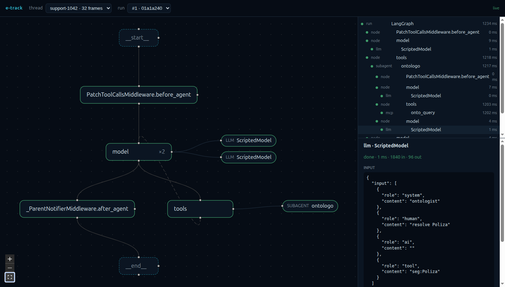

<p align="center">
  <a href="https://github.com/edamlabs/e-track/actions/workflows/ci.yml"></a>
  <a href="https://pypi.org/project/e-track/"></a>
  <a href="https://pypi.org/project/e-track/"></a>
  <a href="LICENSE"></a>
</p>

<p align="center">
  
</p>

**See what your agents are doing.** e-track turns every run of a LangGraph agent — its nodes, model calls, tools, MCP
calls and subagents — into one stream of events, and sends it wherever you look: Langfuse, Phoenix, LangSmith, any
OpenTelemetry backend, your own code, or a live canvas of the graph. Adding a backend never touches the agent, and a
slow backend never slows it.

Part of the **EDamLabs eager series**: EDamLabs' own e- products ([EDamLabs families](https://github.com/edamlabs/e-workbench#identity)).

<p align="center">
  
</p>

## Install

```bash
uv add "e-track[langgraph,otel]"    # or: pip install "e-track[langgraph,otel]"
```

| Extra | For |
|---|---|
| `langgraph` | tracking LangGraph agents (deepagents included) |
| `otel` | Langfuse, LangSmith, Phoenix, Tempo, any OpenTelemetry collector |
| `viewer` | the live canvas (Litestar on granian, React Flow) |
| `all` | everything |

Python 3.14+, typed (`py.typed`).

## Usage

```python
from etrack.logic.api import Tracker
from etrack.logic.channel import EventChannel
from etrack.providers.adapters.bus.anyio import AnyioAdapter
from etrack.providers.adapters.source.langgraph import LanggraphSourceAdapter
from etrack.providers.drivers.sink.otlp import OtlpDriver

async with OtlpDriver() as otlp:                     # targets from ETRACK_OTLP_TARGETS
    bus = AnyioAdapter()
    bus.subscribe(otlp)                              # and the live buffer, and your own sinks
    async with bus:
        tracker = Tracker(EventChannel(bus), LanggraphSourceAdapter())
        with tracker.track(thread="t1", config={}) as run:
            await agent.ainvoke(inputs, run.config)  # your graph, untouched: the config carries the hook
```

```bash
ETRACK_OTLP_TARGETS='{"phoenix": {"endpoint": "http://localhost:6006"}}'
```

And the live canvas, one line more:

```python
viewer = Viewer(watch=live, topology=LanggraphTopologyAdapter().read(agent))
async with GranianAdapter(viewer.app) as server:     # http://127.0.0.1:28130 — or mount viewer.app in your app
    ...
```

| Read | For |
|---|---|
| [Quickstart](https://edamlabs.github.io/e-track/quickstart/) | three steps on a small graph, every output shown |
| [The record](https://edamlabs.github.io/e-track/guide/record/) | what an event holds: kinds, phases, the fields |
| [Backends](https://edamlabs.github.io/e-track/guide/backends/) | Langfuse, Phoenix, LangSmith, Tempo — settings and what is verified |
| [Viewer](https://edamlabs.github.io/e-track/guide/viewer/) | serve or mount the canvas, its API |

The full guide lives at [edamlabs.github.io/e-track](https://edamlabs.github.io/e-track/).

## Development

```bash
make install        # sync deps + prek hooks
make check          # lint + type + arch + validate + test
make cov            # coverage gate: 100 % lines and branches, every outbound service faked in process
make integration    # real services: the session fixtures bring tests/sandbox/compose.yml up and down (collector + Phoenix)
make ci             # every gate CI runs, in one command
```

Stack: uv · ruff · ty · tach · pytest (xdist, randomly, pytest-docker) · prek · zizmor · Zensical · Renovate.
Released from a `v*` tag through PyPI trusted publishing; maintained by the [EDamLabs fleet](https://github.com/edamlabs/e-workbench).
