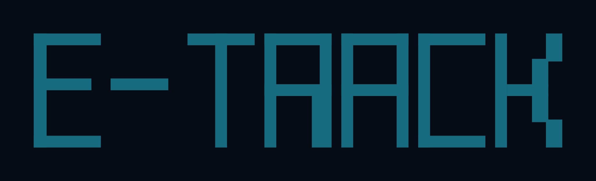

<p align="center">
  <a href="https://github.com/edamlabs/e-track/actions/workflows/ci.yml"></a>
  <a href="https://pypi.org/project/e-track/"></a>
  <a href="https://pypi.org/project/e-track/"></a>
  <a href="LICENSE"></a>
</p>

<p align="center">
  
</p>

Run tracking for agent systems. A source turns a framework's run into **one event model**; the model travels on a
**structlog channel** of its own; a bus fans it out to **parallel sinks**, each reading the partial view it declares.

```
framework hooks ─► source ─► fold ─► channel (validate → publish → forward to host logger)
                                                 │
                                                 └─► bus ─┬─► otlp   spans + logs → Langfuse · LangSmith · Tempo · Phoenix
                                                          ├─► live   per-thread replay + push → a canvas, a chat
                                                          └─► yours  any SinkPort, any EventView
```

Part of the **EDamLabs eager series**: EDamLabs' own e- products ([EDamLabs families](https://github.com/edamlabs/e-workbench#identity)).

## Install

```bash
uv add "e-track[langgraph,otel]"    # or: pip install "e-track[langgraph,otel]"
```

Extras: `langgraph` (LangGraph/deepagents source and topology), `otel` (OTLP driver), `topology` (layout), `all`.
Python 3.14+, typed (`py.typed`).

## Usage

```python
from contextlib import AsyncExitStack

from etrack.logic.api import Tracker
from etrack.logic.channel import EventChannel
from etrack.models.event import EventKind
from etrack.providers.adapters.bus.anyio import AnyioAdapter
from etrack.providers.adapters.sink.live import LiveAdapter
from etrack.providers.adapters.source.langgraph import LanggraphSourceAdapter
from etrack.providers.drivers.sink.otlp import OtlpDriver

async with AsyncExitStack() as stack:                       # the host's composition root
    live = await stack.enter_async_context(LiveAdapter())
    otlp = await stack.enter_async_context(OtlpDriver())
    bus = AnyioAdapter()
    bus.subscribe(live)
    bus.subscribe(otlp, select=lambda event: event if event.part is None else None)  # policy per sink
    await stack.enter_async_context(bus)                   # opened last: closed first, drains into the sinks
    tracker = Tracker(EventChannel(bus), LanggraphSourceAdapter(mcp=frozenset({"onto_query"})))

    with tracker.track(thread="t1", config={"configurable": {"thread_id": "t1"}}) as run:
        await graph.ainvoke({"messages": [("user", "hola")]}, run.config)
        with run.fold.span("gate", kind=EventKind.EVALUATION):
            ...                                             # the project's own code, same tree
```

With the house renderer (`ELogger`) on the host:

```
2026-11-03T12:00:00Z | INFO | run.event || run_id: 019a… || kind: node || phase: start || name: agent || step: 1
```

Every frame is also a line on the host's `etrack` logger, rendered by the host's own structlog setup; e-track never
configures logging.

## The record

| Field | What |
|---|---|
| `run_id`, `thread_id` | the run (32 hex, also the W3C trace id) and the conversation |
| `seq`, `id`, `parent` | order within the run; the span and its visible parent |
| `kind` | `run agent subagent node llm embedding retrieval tool mcp interrupt state evaluation custom` |
| `phase` | `start delta end error instant` |
| `part` | on deltas: `text reasoning tool_call image audio video file custom` |
| `node`, `ns`, `step`, `visit` | graph coordinates: node, subgraph path, superstep, times the run entered the node |
| `message_id`, `call_id` | the chat message and the tool call a client renders |
| `model`, `usage`, `error` | typed sections: provider/name/params, tokens/cost, failure |
| `payload`, `attributes` | what the span carried (redacted); the open, namespaced extension bag |

Grow it by subclassing `RunEvent` and passing the subclass to `EventChannel(model=…)`; read it through an `EventView`.

The full guide lives at [edamlabs.github.io/e-track](https://edamlabs.github.io/e-track/).

## Development

```bash
make install        # sync deps + prek hooks
make check          # lint + type + arch + validate + test
make cov            # coverage gate: 100 % lines and branches, every outbound service faked in process
make integration    # real services: the session fixtures bring sandbox/compose.yml up and down (collector + Phoenix)
make ci             # every gate CI runs, in one command
```

Stack: uv · ruff · ty · tach · pytest (xdist, randomly, pytest-docker) · prek · zizmor · Zensical · Renovate.
Released from a `v*` tag through PyPI trusted publishing; maintained by the [EDamLabs fleet](https://github.com/edamlabs/e-workbench).
